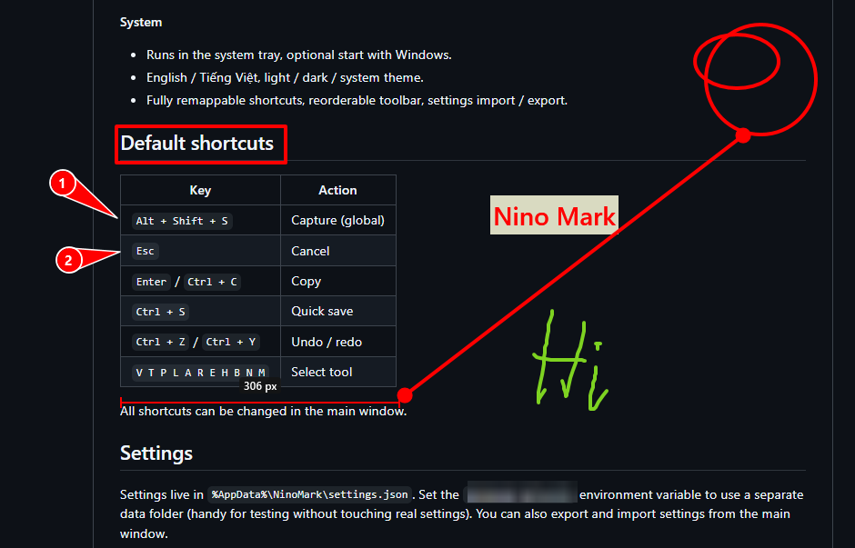

<p align="center">
  
</p>

<h1 align="center">NinoMark</h1>

**English** | [Tiếng Việt](README.vi.md)

[](https://github.com/TokisakiNinoVn/NinoMark/actions/workflows/ci.yml)
[](https://github.com/TokisakiNinoVn/NinoMark/releases/latest)
[](LICENSE)


A fast, lightweight screenshot and annotation tool for Windows, built with C# and WPF (.NET 10).
Press a hotkey, drag a region, draw annotations right on top of it, then copy or save. No separate editor window.

<!-- Add screenshots to docs/images/ and uncomment:


-->

## Download

Grab the latest build from the [Releases page](https://github.com/TokisakiNinoVn/NinoMark/releases/latest), unzip it and run `NinoMark.exe`.
The `win-x64` package already includes .NET, so nothing else needs to be installed.

## Features

**Capture**
- Global hotkey (default `Alt + Shift + S`) captures the monitor under the cursor.
- Drag to select, resize with 8 handles, drag inside to move; magnifier loupe, alignment grid and aspect-ratio lock.

**In-place annotation**
- Tools: select, text, pen, line (plain / ticked / dotted / arrow ends), arrow, rectangle, ellipse, highlight, blur, invert, number, ruler, magnifier.
- Color picker, thickness, opacity, stroke style (solid, dash, dot, double), arrow type, font and font weight.
- Layers panel: rename, show/hide, multi-select, reorder. Edit text and numbers by clicking them; hold `Ctrl` with any tool to select and move objects directly.
- Hold `Shift` for squares, circles and 45° angles. Undo / redo.

**Output**
- Copy to clipboard, quick save to a configured folder, or save as.

**System**
- Runs in the system tray, optional start with Windows.
- English / Tiếng Việt, light / dark / system theme.
- Fully remappable shortcuts, reorderable toolbar, settings import / export.

## Default shortcuts

| Key | Action |
| --- | --- |
| `Alt + Shift + S` | Capture (global) |
| `Esc` | Cancel |
| `Enter` / `Ctrl + C` | Copy |
| `Ctrl + S` | Quick save |
| `Ctrl + Z` / `Ctrl + Y` | Undo / redo |
| `V T P L A R E H B N M` | Select tool |

All shortcuts can be changed in the main window.

## Settings

Settings live in `%AppData%\NinoMark\settings.json`. Set the `NINOMARK_DATA_DIR` environment variable to use a separate data folder (handy for testing without touching real settings). You can also export and import settings from the main window.

## Build from source

Requires Windows 10/11 and the [.NET 10 SDK](https://dotnet.microsoft.com/download).

```powershell
dotnet build .\NinoMark.sln -c Release
dotnet run --project .\src\NinoMark\NinoMark.csproj
```

Publish a self-contained single file:

```powershell
dotnet publish .\src\NinoMark\NinoMark.csproj -c Release -r win-x64 --self-contained true -p:PublishSingleFile=true -o .\publish
```

## Releasing

Pushing a tag such as `v0.4.0` triggers the [release workflow](.github/workflows/release.yml), which builds the app and attaches the zip packages to a GitHub Release.

```powershell
git tag v0.4.0
git push origin v0.4.0
```

## Project structure

```text
NinoMark.sln
src/NinoMark/
├─ App.xaml(.cs)                  # Entry point
├─ MainWindow.xaml(.cs)           # Settings window + global hotkey
├─ Models/AppSettings.cs          # Settings model
├─ Services/                      # Capture, settings, tray, shortcuts, localization, icons
└─ Windows/
   ├─ CaptureWindow.xaml(.cs)     # Overlay: selection + in-place annotation
   ├─ AboutWindow.xaml(.cs)
   └─ InfoListWindow.xaml(.cs)
```

## License

Released under the [MIT License](LICENSE).
